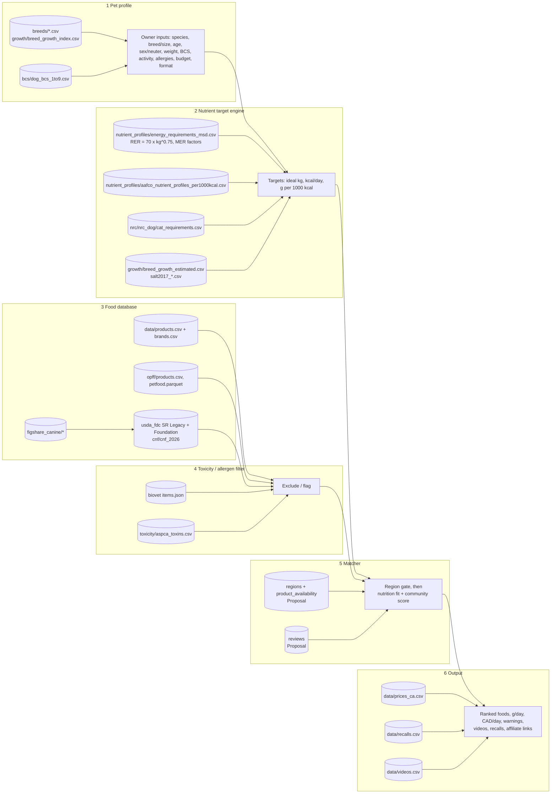
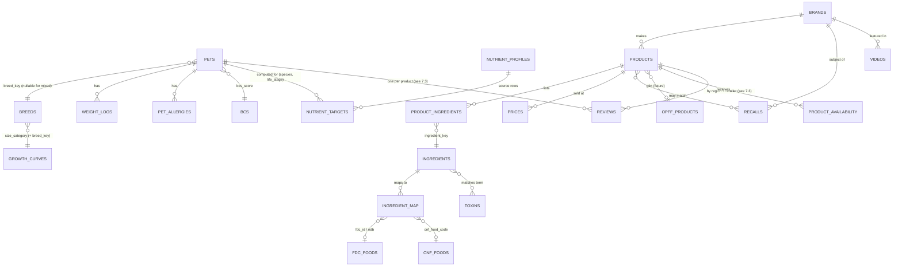
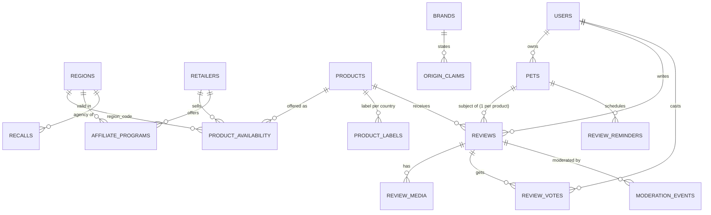
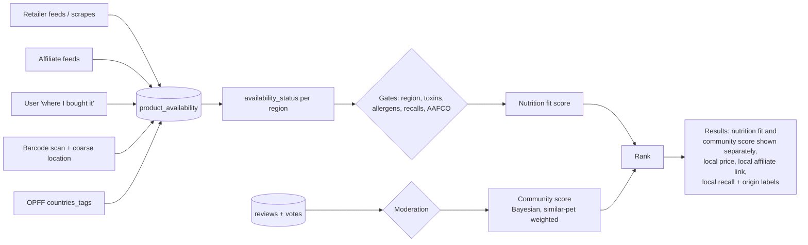

# Pet Diet & Weight Tracker: Data Guide for Developers and Founders

*Version 2, updated 2026-10-20 (PT): adds §7 on regions, availability and reviews. It covers everything under `/workspace/petfood/appdata` and `/workspace/petfood/data`.*

**How to read this guide.** Every count, field name and licence below was checked on 2026-10-20 against the files themselves or the README next to them. If a number comes from a README and was not re-counted, the text says so. When two sources disagree, both numbers are shown. Design proposals (schema, ranking, thresholds) are marked **Proposal**. They are suggestions, not facts from the data.

> **Not veterinary advice.** The app gives general guidance. Any pet with a medical condition, a growing large-breed puppy that needs to lose weight, or a BCS of 1–3 should be referred to a veterinarian.

---

## Contents
1. [Overview and architecture](#1-overview-and-architecture)
2. [Dataset reference](#2-dataset-reference) (one section per dataset)
3. [How the datasets relate](#3-how-the-datasets-relate): join keys, ER diagram, core schema
4. [How each dataset is used in the app](#4-how-each-dataset-is-used-in-the-app): worked dog and cat examples
5. [Gaps and next steps](#5-gaps-and-next-steps)
6. [Licence and attribution checklist](#6-licence-and-attribution-checklist)
7. [Regions, availability and reviews (Proposal)](#7-regions-availability-and-reviews-proposal)

---

## 1. Overview and architecture

**The product.** This is a free, website-first matcher for dogs and cats. It is global, but every list is filtered by the user's country and region; Canada launches first, then the US (see §7). The owner builds a pet profile. The app works out the pet's daily calories and nutrient targets, removes foods that contain toxic or allergen ingredients, and ranks the remaining foods that are sold in the user's region, with local prices, currency and affiliate "buy" links. Owner reviews add a separate community score. Later on, the same data engine can help design and position an in-house organic brand.

**Six layers**

| # | Layer | What it does | Main data |
|---|---|---|---|
| 1 | Pet profile | Collects species, breed (or mixed/size), age, sex/neuter status, weight, BCS, activity, allergies and budget | `breeds/*`, `growth/breed_growth_index.csv`, `bcs/dog_bcs_1to9.csv` |
| 2 | Nutrient target engine | Calculates ideal weight, RER/MER kcal/day and per-1000 kcal nutrient minimums/maximums | `nutrient_profiles/*`, `nrc/*`, `bcs/*`, `growth/*` |
| 3 | Food database | Holds products, label guaranteed analysis, kcal, ingredients and an ingredient → nutrient dictionary | `data/products.csv`, `opff/*`, `figshare_canine/*`, `usda_fdc/*`, `cnf/*` |
| 4 | Toxicity / allergen filter | Removes or flags foods whose ingredients match toxins or the pet's allergens | `biovet/repo/data/items.json`, `toxicity/aspca_toxins.csv`, pet allergy list |
| 5 | Matcher | Region-availability gate, then scores the foods that pass: nutrition fit (targets, life stage, format, budget, origin, recalls) and, separately, a community score from reviews (§7) | outputs of layers 2–4, `data/prices_ca.csv` (→ `product_availability`), `data/recalls.csv`, `data/brands.csv`, `reviews` (new) |
| 6 | Output | Shows a ranked list with grams/day, local cost/day and currency, warnings, local recall sources and origin labels, videos, reviews and regional affiliate links | `data/prices_ca.csv`, `data/videos.csv`, `data/recalls.csv` |



---

## 2. Dataset reference

Paths are relative to `/workspace/petfood/`. "Rows" means data rows, not counting the header.

### Quick index

| Dataset | Path | Licence (short) | Commercial use? |
|---|---|---|---|
| Open Pet Food Facts | `appdata/opff/` | ODbL 1.0 (contents DbCL; images CC BY-SA) | Yes, but **share-alike** on derived databases plus attribution |
| USDA FoodData Central | `appdata/usda_fdc/` | Public domain / CC0 (per README) | Yes |
| Canadian Nutrient File 2026 | `appdata/cnf/cnf_2026/` | Open Government Licence – Canada (per README) | Yes, with attribution |
| Figshare canine diet datasets | `appdata/figshare_canine/` | CC BY 4.0 (per README) | Yes, with attribution. The Hill's product data was scraped from hillspet.co.uk, so treat product text with care |
| BioVet pet-food-safety | `appdata/biovet/repo/` | Data CC BY 4.0, code MIT | Yes, with the required attribution line |
| Kaggle breed tables (3 sets) | `appdata/breeds/` | CC0 (per README) | Yes |
| Kaggle/TidyTuesday AKC dog-breeds | `appdata/breeds/dog-breeds/` | "Other", AKC data | **Treat as NOT cleared for commercial use** |
| AAFCO 2014 nutrient profiles (CSV) | `appdata/nutrient_profiles/` | Facts from a public AAFCO PDF; cite source | Facts OK; do not republish the PDF/text |
| MSD energy table | `appdata/nutrient_profiles/energy_requirements_msd.csv` | Cite source | Formulas are facts; cite |
| NRC protein (via MSD) | `appdata/nrc/` | Cite source; NRC book is paid | Facts only |
| ASPCA toxins | `appdata/toxicity/` | ASPCA pages (no open licence stated) | Use as short facts with link; do not copy the pages |
| AAFCO Chapter 6 (ingredient definitions) | `appdata/aafco/` | **© AAFCO, no machine-readable conversion** | **No.** Internal reference only |
| Dog BCS 1–9 | `appdata/bcs/` | Descriptions CC BY 4.0; AAHA numbers are facts only | Yes for descriptions, with attribution |
| Salt 2017 growth data | `appdata/growth/` | CC BY 4.0 | Yes, with attribution |
| Canadian starter catalogue | `data/` | Built in-house from cited pages | Our own compilation. Check the terms of each source site before republishing text |

---

### 2.1 Open Pet Food Facts (OPFF)

- **What:** A crowd-sourced, open database of pet food products (like Open Food Facts, but for pets). Each product has a barcode, name, brand, categories, countries, ingredient text and nutrient values per 100 g.
- **Source:** `static.openpetfoodfacts.org/data/en.openpetfoodfacts.org.products.csv.gz`. The parquet file is from Hugging Face `openfoodfacts/product-database` (`petfood.parquet`). The MongoDB dump is the official one, dated 2026-10-15 (per README).
- **Licence:** **ODbL 1.0** for the database, DbCL for the contents, **CC BY-SA** for images.
  - ⚠️ **Share-alike:** if you publish a *derived database* built from OPFF (for example, our product table with OPFF rows merged in), that derived database must also be offered under ODbL, and you must credit OPFF.
  - **Proposal:** keep OPFF-derived rows in a separate table or layer, so the in-house Canadian catalogue and the scoring logic stay outside the share-alike scope. Get legal advice before launch.
- **Files**

  | File | Size | Rows | Notes |
  |---|---|---|---|
  | `opff/products.csv` | 37,868,347 bytes | **15,136** | Tab-separated even though the extension is .csv; 210 columns |
  | `opff/en.openpetfoodfacts.org.products.csv.gz` | 3,294,294 bytes | — | Original download |
  | `opff/petfood.parquet` | 8,126,885 bytes | **15,514** | 92 columns, nested `nutriments` and `ingredients`. It is a different export from the CSV, so the row counts differ |
  | `opff/openpetfoodfacts-mongodbdump.gz` | 22,059,518 bytes | not restored | Needs `mongorestore` |
  | JSONL export | — | — | Upstream file was empty (20 bytes) on 2026-10-20 (README) |

- **Key fields:** `code` (barcode), `product_name`, `brands`, `categories_tags`, `countries_tags`, `ingredients_text`, plus 122 `*_100g` nutrient columns. The most useful are `proteins_100g`, `fat_100g`, `fiber_100g`, `energy-kcal_100g`, `calcium_100g` and `phosphorus_100g`.
- **Coverage (counted by me from the CSV, 2026-10-20)**

  | Measure | Count |
  |---|---|
  | Total products | 15,136 |
  | Tagged Canada (`countries_tags` contains `en:canada`) | 254 (140 of these have no brand filled in) |
  | Dog-related categories and Canada | 34 |
  | Tagged United States | 943 |
  | Any `*_100g` value | 598 |
  | Ingredient text | 2,825 |
  | Both nutrients and ingredients | 393 |

- **How filled the nutrient columns are:** `energy-kcal_100g` 313, `proteins_100g` 241, `fat_100g` 240, `calcium_100g` 107, `phosphorus_100g` 100, `fiber_100g` 74.
- **Category tags:** `en:cat-food` 1,783; `en:dog-and-cat-food` 1,501; `en:dog-food` 1,092; `en:dry-cat-food` 331; `en:wet-cat-food` 270; `en:dry-dog-food` 223; `en:wet-dog-food` 112.
- **Dog/cat totals:** a substring match for "dog" in `categories_tags` gives 2,029. The README's heuristic gives "dog ≈2,032, cat ≈2,369". Treat both as approximate.
- **Caveats**
  - OPFF is thin for Canada.
  - Nutrition values are usually *not* the pet guaranteed analysis (min/max). Often they are entered in a human-food layout.
  - Many products have no brand.
  - The data is crowd-sourced and unverified.
  - The CSV is tab-separated.
  - The two exports (CSV and parquet) differ in row count.

### 2.2 USDA FoodData Central (FDC)

- **What:** The US government's food composition data. We use it as the **ingredient → nutrient dictionary** (for example, "chicken liver, raw" → protein, fat, Ca, P and so on per 100 g).
- **Source:** `fdc.nal.usda.gov/fdc-datasets/…`. **Licence:** public domain / CC0 (README). Commercial use is fine; citing USDA is good practice.
- **Path and size:** `appdata/usda_fdc/` is 507 MB in total, including the branded zip.

  | Part | Folder | Rows I counted |
  |---|---|---|
  | Foundation Foods (2026-04-30) | `FoodData_Central_foundation_food_csv_2026-04-30/` | `food.csv` 87,990 rows (all data types, mostly `sub_sample_food` 75,055); `foundation_food.csv` **395**; `food_nutrient.csv` 170,469; `nutrient.csv` 477 |
  | SR Legacy (2018-04) | `FoodData_Central_sr_legacy_food_csv_2018-04/` | `food.csv` **7,793**; `sr_legacy_food.csv` 7,793 (`fdc_id` → `NDB_number`); `food_nutrient.csv` 644,125; `nutrient.csv` 474 |
  | Branded foods (2026-04-30) | `FoodData_Central_branded_food_csv_2026-04-30.zip` | **Not extracted.** README: 428 MB zip / 3.09 GB unzipped. These are human branded foods, keyed by `gtin_upc` |

- **Key fields:** `food.fdc_id`, `food.description`, `food.food_category_id`, `sr_legacy_food.NDB_number`, `food_nutrient(fdc_id, nutrient_id, amount)` (per 100 g edible portion), `nutrient(id, name, unit_name)`.
- **Caveats**
  - These are human foods, raw or cooked. Pet-food rendered meals ("chicken meal", "by-product meal") are mostly **not** in FDC.
  - SR Legacy is frozen at 2018.
  - SR Legacy descriptions use sentence case ("Pork, fresh, loin…"). The figshare map uses the old upper-case abbreviated style ("PORK,FRSH,LOIN…"), so **matching on description text fails (0 of 40)**. Join on the NDB number instead (see §3).

### 2.3 Canadian Nutrient File (CNF) 2026

- **What:** Health Canada's food composition database. It is bilingual (EN and FR). This is the Canadian counterpart to FDC.
- **Source:** open.canada.ca dataset `1b6139bd-ed7e-4043-bc28-ff00e10f3109`. **Licence:** Open Government Licence – Canada (README). Commercial use is allowed with attribution.
- **Path:** `appdata/cnf/cnf_2026/` (51 MB) plus `cnf_2026_all.zip`. The user guide and structure PDFs are included in both languages.
- **Rows (counted)**
  - `Food_Name.csv`: 5,993
  - `Nutrient_Name.csv`: 173
  - `Nutrient_Amount.csv`: 565,409
  - `Measure_Weight_Conversion.csv`: 29,868
  - `CNF_Food_Group.csv`: 23
- **Key fields**
  - `Food_Name`: `Food_Code`, `Food_Description_EN/FR`, `CNF_Food_Group_Code`, **`USDA_NDB_Code`** (filled for 4,798 of 5,993 foods).
  - `Nutrient_Amount`: `Food_Code`, `Nutrient_Code`, `Nutrient_Amount`.
  - `Nutrient_Name`: for example 203 Protein (g), 204 Fat (g), 208 Energy (kcal), 255 Moisture (g), 291 Fibre (g), 301 Calcium (mg), 305 Phosphorus (mg).
- **Caveats**
  - The files are UTF-8 with a BOM. Read them with `utf-8-sig`, because cp1252/latin-1 readers fail.
  - These are human foods.
  - A shared `USDA_NDB_Code` points to a *related* USDA food. It does not guarantee identical values, because Canadian foods are often fortified differently.

### 2.4 Figshare "Canine diet datasets" (article 30344017)

- **What:** Seven CSVs from a research data package: breed disease predispositions, Hill's product nutrients, a Russian clinic's disease counts, an ingredient nutrient table (EN/RU) and a **pet-ingredient → USDA name map**.
- **Licence:** CC BY 4.0 (README). Attribution is required. Commercial use is allowed.
  - The Hill's rows were scraped from hillspet.co.uk (the URLs are in the file). Use them for analysis, but do not republish Hill's marketing text.
- **Path:** `appdata/figshare_canine/` (3.1 MB)

| File | Rows | Key fields | Notes |
|---|---|---|---|
| `ingredient_standardization.csv` | **40** | `Ingredient_pet_food` (e.g. `chicken_liver`), `Category`, `Ingredient_USDA` (e.g. `CHICKEN,LIVER,ALL CLASSES,RAW`) | The starter synonym table. All 40 match `food_ingrediets_2025.csv.Description` |
| `food_ingrediets_2025.csv` (sic) | **126** | `Nutrient Data Bank Number` (NDB), `Category`, `Description`, then Russian-named nutrient columns (calories, moisture, protein, fat, Ca, P, …) | 125 of 126 NDB numbers match USDA SR Legacy `NDB_number`; 118 match a CNF `USDA_NDB_Code` |
| `dog_food_Hills_Pet_Nutrition.csv` | **305** | `url`, `product title`, `breed_size`, `life_stage`, `food_form`, `ingredients` (tokenised list), `protein`, `fat`, `calcium`, … (numeric %) | UK Hill's site. 185 dry, 120 wet. `life_stage` is "-" for 155 rows |
| `Product_and_nutrients.csv` | **49** | Same nutrient columns as text with units ("4.20%", "20479 IU/kg") | Raw (uncleaned) version of a subset |
| `dog_breed_diseases.csv` | **4,093** | `Breed` (lower case), `Type_of_disorder`, `Disease`, `Predisposition_to_disease`, `Size`, `Group_UK`, `Group_AKC`, `Alternative_breed_names` | 482 distinct breeds. Labrador Retriever has 37 rows. `Alternative_breed_names` is useful for alias matching |
| `Canine_disease_and_disorders.csv` | **99** | `Disorder`, `Disease`, `Breed`, min/max height/weight, temperament… | Only 15 distinct breeds |
| `Vetclinic_dataset.csv` | **9** | Semicolon-separated, Russian headers: breed, count, urolithiasis, enteropathy, pancreatitis, hepatopathy, CKD, diabetes, obesity, translated name, size | Clinic counts from one practice; anecdotal |

**Caveats**
- Hill's numbers are UK labels, and many vitamin cells are 0, meaning "not given".
- `food_ingrediets_2025.csv` has Russian headers.
- The ingredient map covers only 40 common whole-food ingredients. It has no "chicken meal", "pea protein" and so on.

### 2.5 BioVet pet-food-safety (toxicity)

- **What:** A vet-reviewed list of foods, plants, medications and household hazards. Each item has a safe/caution/danger verdict for each species.
- **Source:** `github.com/Bio-Vet/pet-food-safety`. The local clone's last commit is `5cee4b3`, 2026-10-01 05:33 PT. `meta.version` is 1.3.0 and `meta.last_review` is 2026-10.
- **Licence:** **Data CC BY 4.0** (`LICENSE`) and code MIT (`LICENSE-CODE`). The required attribution is "Data: BioVet veterinary clinic network, bio.vet".
- **Path:** `appdata/biovet/repo/data/items.json` (one JSON file). The schema is in `schema/items.schema.json`.
- **Rows:** **101 items**: 43 food, 44 plant, 10 household, 4 medication. The README badge says "items-91", but the file and the README text say 101.
- **Key fields:** `id`, `category`, `names.en[]` / `names.ru[]`, `verdicts.{dog,cat,rabbit_rodent,bird,reptile}`, `toxin`, `notes.en`, `sources[]`, `evidence` (consensus / typical / clinic-reviewed), `toxic_dose`.
- **Verdict counts:**
  - Dog: danger 39, caution 39, safe 18, missing 5.
  - Cat: danger 40, caution 41, safe 14, missing 6.
- **Toxic doses:** 7 items have a `toxic_dose`: grapes-raisins, chocolate-cocoa, onion-garlic-leek, xylitol, ibuprofen-nsaids, antifreeze, nicotine-vapes.
- **Caveats**
  - The verdicts are about *feeding the item as a food or treat*. They are not about an ingredient inside a complete, balanced commercial diet. For example, `potato`, `spinach`, `wheat` and `barley` are "caution", and `mushrooms` is "danger" ("any wild mushroom can be lethal — simpler to ban them all").
  - Auto-excluding every "caution" ingredient would wipe out most kibble. See the filter rules in §4.5.
  - A missing species key means "not assessed", not "safe".
  - The source clinic network is in Moscow.

### 2.6 ASPCA toxins

- **What:** Short list of toxic people-foods plus the ASPCA top-10 toxin categories for 2025.
- **Path:** `appdata/toxicity/aspca_toxins.csv` has **29 rows**: 19 "People Foods to Avoid" plus 10 "Top 10 Toxins 2025". The source files `aspca_people_foods_to_avoid.html` and `aspca_top10_toxins_2025.pdf` (an image-only infographic) are kept alongside.
- **Fields:** `item`, `species`, `severity_notes`, `list`, `source_url`.
- **Licence:** ASPCA web pages. No open licence is stated. Use them as cited short facts with a link back. Do not copy page text.
- **Caveats**
  - The top-10 rows are exposure categories (for example "Rodenticides (6.5%)"), not ingredients.
  - **The sources disagree on avocado.** ASPCA says it is mainly a problem for birds, rabbits, horses and ruminants, and does not list dogs and cats as the main concern. BioVet marks it "danger" for dogs and cats.
  - Proposal: flag avocado, and show both sources.

### 2.7 Breed tables (Kaggle)

Path: `appdata/breeds/`. The licences come from the README.

| File | Rows | Licence | Key fields | Caveats |
|---|---|---|---|---|
| `dog-breeds-details/dog_breeds.csv` | **97** | CC0 | `Name`, min/max height & weight by sex (**pounds / inches**), life expectancy, temperament 1–5 | Unverified. The README notes an Alaskan Klee Kai row of 100–130 lb, which is clearly wrong. Labrador: male 65–80 lb, female 55–70 lb |
| `top-dog-breeds-around-the-world/Dog Breads Around The World.csv` | **159** | CC0 | `Name`, `Origin`, `Type`, `Size` (Small/Medium/Large…), `Average Weight (kg)`, `Exercise Requirements (hrs/day)`, `Health Issues Risk` | Single average weight. Labrador = 30 kg |
| `cat-breeds-details/cat_breeds.csv` | **62** | CC0 | `name`, `origin`, `min_weight`, `max_weight`, life expectancy, traits 1–5 | **Weight unit not labelled.** Values look like pounds (Maine Coon 9–18, Persian 7–12). Verify before use |
| `dog-breeds/` (TidyTuesday/AKC): `breed_traits.csv` 195, `breed_rank.csv` 195, `breed_traits_long.csv` 3,120, `trait_description.csv` 16 | — | **"Other", AKC data. Treat as NOT cleared for commercial use** | AKC-style names such as `Retrievers (Labrador)`, with **non-breaking spaces** (`\xa0`) in `breed_traits.csv` | Use only internally (e.g. popularity for ordering a dropdown) until cleared |

### 2.8 AAFCO nutrient profiles (per 1000 kcal ME)

- **What:** AAFCO 2014 revised Dog and Cat Food Nutrient Profiles, on a calorie basis. These are the minimums, and some maximums, that the matcher checks against.
- **Path:** `appdata/nutrient_profiles/aafco_nutrient_profiles_per1000kcal.csv` has **88 rows: 42 dog, 46 cat**.
  - Fields: `species`, `nutrient`, `unit_per_1000kcal_ME`, `growth_reproduction_min`, `adult_maintenance_min`, `maximum`, `source_url`, `source_note`.
  - Source PDF: `Pet_Food_Report_Annual_2014-Appendix_A-Revised_AAFCO_Nutrient_Profiles-Final_092214.pdf`. `p.txt` is a 1,326-line plain-text extraction of that PDF.
- **Verification:** the README says the values were re-checked against the PDF on 2026-10-20 (pp. 6–7 dog, pp. 15–16 cat) and all matched.
- **Licence:** these are facts from a public AAFCO PDF; cite AAFCO. **Do not ship `p.txt` or the PDF publicly.**
- **Key values used in the examples**

  | Nutrient (per 1000 kcal ME) | Dog growth | Dog adult | Dog max | Cat growth | Cat adult |
  |---|---|---|---|---|---|
  | Crude protein (g) | 56.3 | 45.0 | — | 75 | 65 |
  | Crude fat (g) | 21.3 | 13.8 | — | 22.5 | 22.5 |
  | Calcium (g) | 3.0 | 1.25 | 6.25 (4.5 for large-breed puppies) | 2.5 | 1.5 |
  | Phosphorus (g) | 2.5 | 1.00 | 4.0 | 2.0 | 1.25 |
  | Taurine (g) | — | — | — | 0.25 extruded / 0.50 canned | same |

- **Caveats**
  - Some cells are text, not numbers: "ND" (not determined), "6.25 (4.5 for large-breed puppies)", and ratios like "1:1" or "30:1". Parse them carefully.
  - These are the 2014 profiles. Check whether AAFCO has published later changes before launch.

### 2.9 Energy requirements (MSD Veterinary Manual)

- **Path:** `appdata/nutrient_profiles/energy_requirements_msd.csv` has **11 rows**. Fields: `species`, `life_stage_or_status`, `formula_kcal_per_day`, `source_url`.
- **Content**
  - RER = `70 * BW_kg^0.75`. A linear version, `30 * BW_kg + 70`, applies only to 2–45 kg.
  - Dog MER factors: adult intact 1.8, adult neutered 1.6, obesity-prone 1.4, puppy <4 months 3.0, puppy >4 months 2.0.
  - Cat MER factors: adult intact 1.4, adult neutered 1.2, obesity-prone 1.0, kitten 2.5 (or free choice).
- **Licence:** cite MSD. Formulas are facts.
- **Caveat:** there is no activity factor for working or very active dogs in this table.

### 2.10 NRC requirements (protein only)

- **Path:** `appdata/nrc/nrc_dog_requirements.csv` (1 row) and `nrc_cat_requirements.csv` (1 row), plus `nap_dog_nutrition_pamphlet.pdf`, the free NRC owner pamphlet. The pamphlet gives daily amounts for a 33-lb dog and has not been parsed.
- **Content (g protein per 1000 kcal ME)**
  - Dog: adult about 20; growth 45 at 4–14 weeks, 35 after 14 weeks.
  - Cat: adult 40, kitten 45.
- **Licence:** facts reprinted by MSD. The full NRC 2006 book is paid (National Academies Press) and was not obtained.
- **Caveat:** **protein only.** NRC values are lower than AAFCO's. Use AAFCO as the compliance target and show NRC only as context.

### 2.11 AAFCO Official Publication Chapter 6 (ingredient definitions)

- **Path:** `appdata/aafco/2025_OP_Chapter_6_enc.pdf` (about 1 MB, 208 pages per README) and `appdata/aafco/README.md`.
- **Licence:** **© AAFCO.**
  - The PDF's own notice (p.1) forbids reducing it "to any electronic medium or machine-readable form, in whole or in part, without the prior written consent of AAFCO".
  - AAFCO also forbids using it as AI training data.
- ⚠️ **Not machine-readable for us.** `aafco_ch6_ingredients.csv` was deliberately **not** created. Use the PDF only as a human lookup reference.
- To get a structured ingredient-definition table, get written consent or license the paid AAFCO Online Database of Ingredients.

### 2.12 Body Condition Score (dog, 1–9)

- **Path:** `appdata/bcs/dog_bcs_1to9.csv` has **9 rows** (scores 1–9). The source article is `animals-09-01035_PMC6940832.xml`.
- **Fields:** `score`, `label`, `description`, `approx_pct_vs_ideal_weight`, `approx_pct_body_fat`, `five_point_equiv`, `calorie_guidance`, `source_url`.
- **Content**
  - 4–5 = Ideal (0%).
  - 6 = +10%, 7 = +20%, 8 = +30%, 9 = +40% over ideal weight. Each point above 5 is +10%, per AAHA 2014.
  - Body fat ranges run from 15–19% (score 4) to 40–45+% (score 9).
  - For scores 6–9, `calorie_guidance` holds the AAHA weight-loss rule: feed 80% of current intake, or 80% of RER at ideal weight, aiming to lose 1–2% of body weight per week.
- **Licence**
  - Descriptions are quoted verbatim from Jacobson et al. 2019, *Animals* 9:1035 (CC BY 4.0, Purina/Laflamme wording).
  - The numeric facts come from AAHA 2014 (© AAHA; only facts and paraphrase taken; PDF not saved).
- **Gaps (from README)**
  - Scores 1–3 have no % below ideal and no calorie guidance.
  - Scores 4–5 have no calorie guidance.
  - **There is no cat BCS table.**

### 2.13 Dog growth curves (Salt et al. 2017, Banfield data)

- **Path:** `appdata/growth/` (1.3 GB in total, mostly the raw CSV and zip).
- **Licence:** paper and data CC BY 4.0 (DataCat 377, doi 10.17638/datacat.liverpool.ac.uk/377). Attribution is required.

| File | Size / rows | What |
|---|---|---|
| `Final_Data_PLOS.csv` | 1,153,618,697 bytes; **14,957,947 rows** per the DataCat readme | Raw visits: `BREED ID` (disguised), `PET ID`, `GENDER`, `VISIT_AGE` (yr), `WEIGHT` (kg), `BCS_RECORDED`/`BCS_PREDICTED` (Thin/Normal/Heavy), `AV_BREED-WEIGHT`… US Banfield purebred dogs under 3 years, 1994–2013 |
| `salt2017_table1_size_categories.csv` | 6 rows | Size categories I (<6.5 kg) to VI (40+ kg) with the paper's named breeds. Labrador, Golden, German Shepherd and American Bulldog are in **V (30 to <40 kg)** |
| `salt2017_empirical_weight_by_sizecat_month.csv` | 216 rows (6 categories × 36 months) | `size_cat`, `age_month`, `n_visits`, `n_dogs`, percentiles `p02,p09,p25,p50,p75,p91,p98` (kg), Normal-BCS visits only |
| `salt2017_empirical_weight_by_breedid_month.csv` | 1,116 rows | The same, by disguised breed ID (cells with ≥30 visits). **Breed names cannot be recovered** |
| `breed_growth_index.csv` | **184 rows** | `breed`, `breed_key` (normalised), `size_category`, `assignment_method` (paper_table1 / adult_weight), `weight_based_category`, adult weight min/max kg, `sexes_available`, `sources` |
| `breed_growth_estimated.csv` | **13,608 rows** | `breed`, `sex` (male/female/all), adult weight range, `size_category`, `month_age` 0–35, percentiles, `scaled_p50` |
| `build_salt2017_summaries.py`, `build_breed_growth.py` | — | Scripts that rebuild the derived files |

- **Caveats (from README)**
  - The per-breed curves are **ESTIMATES**. Each breed inherits its size category's percentiles. Only `scaled_p50` is adjusted, by the breed's adult weight, with the ratio clamped to 0.6–1.6.
  - The percentiles are empirical, not the paper's fitted GAMLSS centiles.
  - Month 0 is noisy.
  - The curves are not split by sex.
  - The data is from a US population.
  - Kaggle adult weights are unverified.
  - **There is no cat growth data.**

### 2.14 Canadian starter catalogue (`/workspace/petfood/data`)

Built 2026-10-20 (PT). Every fact has a source URL in its `sources` or `url` column. Blanks mean "not found". Scripts and raw pulls are in `data/raw/`.

| File | Rows (counted) | Key fields | Notes |
|---|---|---|---|
| `brands.csv` | **31** | `brand`, `species`, `parent_company`, `hq_country`, `canadian_owned`, `where_manufactured_per_maker`, `formats`, `website`, `sources`, `notes` | `canadian_owned` is "Y" for 9 rows, plus "Y (per madeinca.ca; Petcurean filing)" for Now Fresh and "Y (per search sources; verify)" for Carna4 = 11 rows starting with Y. The README says "10 are Canadian-owned". Treat Carna4 as unverified |
| `products.csv` | **65** (dog 31, cat 34) | `id`, `brand`, `product_name`, `species`, `life_stage`, `format`, `first_10_ingredients`, `full_ingredients`, `protein`, `fat`, `fibre`, `moisture`, `kcal_per_kg`, `kcal_per_cup`, `kcal_per_can`, `package_size`, `product_url`, `data_source`, `notes` | 40 rows come from verifiedpetfooddata.com (**US label transcriptions**; Canadian formulas may differ; ingredient lists may be truncated). 25 were auto-extracted from Canadian brand pages ("verify"). Fill counts: `kcal_per_kg` 41, `protein` 54, `moisture` 37, `full_ingredients` 59. `life_stage` is blank for 24 rows and sometimes contains extra text ("adult cats · made by Nestlé…"). Formats: dry 39, wet 17, others raw/freeze-dried/fresh/air-dried. **No barcode/UPC column.** Guaranteed analysis is stored as text such as "29% min" or "6% max" |
| `prices_ca.csv` | **61** price rows covering 24 distinct products | `product_id`, `retailer` (Homes Alive 50, Smack brand store 11), `price_cad`, `size`, `size_kg`, `price_per_kg`, `date`, `url`, `match_note`, `COMPUTED_cost_per_day_cat_10lb / dog_30lb / dog_60lb`, `cost_method`, `feeding_guide_amount_used` | Cost/day is a **calorie-based estimate**. Daily kcal = RER × 1.2 for a neutered cat and × 1.6 for a neutered dog (10-lb cat 261, 30-lb dog 794, 60-lb dog 1,335 kcal). Per the README, cost/day exists where kcal/kg and size are both known (24 rows). Feeding-guide amounts were **not** collected |
| `recalls.csv` | **8** | `brand`, `agency`, `date`, `title`, `product`, `reason`, `url`, `source` | US FDA: Fromm 2025-12-03 (plastic) and 2026-08-21 (metal); Hill's 2019-01-31 and 2019-05-21 (vitamin D); **Northwest Naturals Chicken Recipe 2026-08-28 (Salmonella/Listeria)**. Health Canada/CFIA: Instinct 2015-08-25; Kirkland Signature and Wellness CORE 2012-05-18 (product and reason blank). The FDA table is not a full history |
| `videos.csv` | **363** (YouTube only) | `brand`, `species`, `video_title`, `creator`, `url`, `embed_url`, `views`, `duration_s`, `type` (review 206 / taste test 84 / other 73), `query` | Covers all 31 brands (Horizon Pulsar has only 2). Upload `date` is "not in flat metadata". Filtered by keyword, so review before embedding. No TikTok |
| `data.json` | — | `{generated: "2026-10-20", brands: [ {brand fields…, products, videos, recalls} ]}` | Everything nested by brand, ready for a static site |

**Licence:** our own compilation of facts with source links. Product text and photos belong to the brands. Video embeds follow YouTube's terms.

---

## 3. How the datasets relate

### 3.1 Join keys

| Key | Links | How (verified 2026-10-20) | Quality |
|---|---|---|---|
| **Barcode / `code`** | OPFF product ↔ our `products` | OPFF has `code`. **`data/products.csv` has no barcode**, so today the only route is fuzzy brand + product name. **Proposal:** add a `gtin` column and capture UPCs from retailer pages. The USDA Branded `gtin_upc` is for human foods and will rarely help | Weak today |
| **Ingredient name → nutrient row** | label ingredient → `ingredient_map` → FDC / CNF | 1) Normalise the label token (lower case, underscores), for example `chicken liver` → `chicken_liver`. 2) `figshare_canine/ingredient_standardization.Ingredient_pet_food` → `Ingredient_USDA` (40 rows). 3) `Ingredient_USDA` = `food_ingrediets_2025.Description` (**40 of 40 match**) → `Nutrient Data Bank Number`. 4) NDB = `usda_fdc SR Legacy sr_legacy_food.NDB_number` (**125 of 126 match**) → `fdc_id` → `food_nutrient`. 5) Optionally NDB = `cnf Food_Name.USDA_NDB_Code` (**118 of 126 match; 37 of the 40 mapped ingredients**) → CNF `Food_Code` → `Nutrient_Amount`. Matching the description text directly to SR Legacy gives **0 of 40** (different text style), so always go via NDB | Good for 40 whole-food ingredients. None yet for meals, by-products, isolates or premixes |
| **Breed name** | Kaggle `dog_breeds.csv.Name`, Kaggle world `Name`, figshare `dog_breed_diseases.Breed` (+ `Alternative_breed_names`), growth `breed_growth_index.breed_key`, AKC `Breed` | Use `breed_key`: lower case, punctuation stripped, plus an alias map. The growth build already does this (e.g. Maltese Terrier → Maltese, English Bulldog → Bulldog, Great Pyrenees = Pyrenean Mountain Dog). AKC names are inverted ("Retrievers (Labrador)") and contain `\xa0`. Figshare names are lower case ("labrador retriever"). Salt raw data has **disguised** breed IDs only | Medium. Needs a hand-maintained `breed_alias` table |
| **Size category** | growth (I–VI) ↔ figshare `Size` ↔ Kaggle world `Size` ↔ Hill's `breed_size` ↔ AAFCO "large-breed puppy" Ca max | Salt cut-offs: I <6.5, II 6.5–<9, III 9–<15, IV 15–<30, V 30–<40, VI 40+ kg. Figshare `Size` uses small / small-medium / medium / medium-large / large / extra large / none. **Proposal:** I–II = small, III–IV = medium, V–VI = large (the AAFCO 2014 document, `p.txt` lines 344 and 498, defines large-size puppies as those reaching 70 lb (≈31.8 kg) or more as mature lean adults; that is where the 4.5 g Ca max applies) | Mapping is a product decision |
| **Life stage** | pet age → AAFCO `growth_reproduction_min` vs `adult_maintenance_min`; product `life_stage`; MSD MER factor | Product `life_stage` is free text ("adult dogs", "all dogs", "puppy dogs", "kitten cats", "all life stages", blank). **Proposal:** normalise to `growth` / `adult` / `all_life_stages` / `unknown`. "All life stages" foods must meet the growth profile | Needs cleaning |
| **Species** | everything | `dog` / `cat`. BioVet keys are `dog` / `cat`. ASPCA uses "dogs;cats" strings | Easy |
| **Brand** | `brands.brand` ↔ `products.brand` ↔ `videos.brand` ↔ `recalls.brand` ↔ OPFF `brands` | Exact match inside `data/`. Recalls use sub-brand strings ("Hill's Science Diet", "Wellness CORE", "Kirkland Signature"), so map them to the parent brand | Good in `data/`; fuzzy for OPFF |
| **Product** | `products.id` ↔ `prices_ca.product_id` | Exact slug | Good |
| **Toxin term** | ingredient tokens ↔ BioVet `names.en[]` ↔ ASPCA `item` | Word-boundary match on normalised tokens. Avoid naive substrings ("sweet potato" contains "potato") | Medium |

### 3.2 Entity-relationship diagram (proposed)



### 3.3 Proposed core schema (**Proposal**, PostgreSQL-style)

```sql
-- Reference / knowledge tables -------------------------------------------
breeds(breed_key PK, species, display_name, aliases text[],
       adult_weight_min_kg, adult_weight_max_kg, size_category,   -- from growth/breed_growth_index.csv
       size_assignment_method, source)                            -- cats: breeds/cat_breeds.csv (unit to verify)

growth_curves(size_category, breed_key NULL, sex, month_age,
              p02, p09, p25, p50, p75, p91, p98, scaled_p50,
              is_estimate bool, source)                           -- growth/*.csv ; dogs only

bcs(species, score PK, label, description, pct_vs_ideal, pct_body_fat,
    five_point_equiv, calorie_guidance, source_url)               -- bcs/dog_bcs_1to9.csv ; dog only today

nutrient_profiles(species, nutrient, unit, growth_min, adult_min,
                  max_value, max_note, source)                    -- AAFCO CSV (+ NRC protein as context)

energy_factors(species, status, multiplier, note, source)         -- energy_requirements_msd.csv

toxins(toxin_id PK, terms text[], category, dog_verdict, cat_verdict,
       toxin, toxic_dose, notes, evidence, source, licence)       -- biovet items.json + aspca_toxins.csv

ingredients(ingredient_key PK, display_name, category)            -- normalised label tokens
ingredient_map(ingredient_key FK, ndb_number, fdc_id, cnf_food_code,
               match_method, confidence)                          -- figshare map -> FDC/CNF via NDB

-- Catalogue -------------------------------------------------------------
brands(brand_id PK, name, parent_company, hq_country, canadian_owned,
       canadian_owned_verified bool, made_in, website, sources)
products(product_id PK, brand_id FK, name, species, life_stage_norm,
         format, gtin NULL, kcal_per_kg, kcal_per_cup, kcal_per_can,
         ga_protein_min, ga_fat_min, ga_fibre_max, ga_moisture_max,      -- numeric % as-fed
         ga_calcium_min NULL, ga_phosphorus_min NULL,
         ingredients_text, ingredients_truncated bool,
         label_region ('CA'|'US'|'UK'), data_source, verified bool)
product_ingredients(product_id FK, position int, ingredient_key FK, raw_text)
prices(product_id FK, retailer, price_cad, size_kg, price_per_kg,
       observed_on date, url, affiliate_url NULL, match_note)
recalls(recall_id PK, brand_id FK, product_id NULL, agency, date,
        title, reason, url)
videos(video_id PK, brand_id FK, product_id NULL, species, title,
       creator, embed_url, views, type, reviewed bool)

-- User data -------------------------------------------------------------
pets(pet_id PK, owner_id, species, name, breed_key NULL, mixed_size NULL,
     birth_date, sex, neutered bool, activity, food_formats text[],
     budget_cad_per_day NULL, created_at)
weight_logs(pet_id FK, measured_on, weight_kg, bcs_score)
pet_allergies(pet_id FK, ingredient_key)
nutrient_targets(pet_id FK, computed_on, ideal_weight_kg, rer_kcal,
                 kcal_per_day, life_stage, nutrient, min_per_1000kcal,
                 max_per_1000kcal, method_note)

-- Region and review tables (regions, retailers, affiliate_programs,
-- product_labels, product_availability, origin_claims, reviews,
-- review_media, review_votes, moderation_events, review_reminders)
-- are defined in §7.3. product_availability replaces `prices`.
```

---

## 4. How each dataset is used in the app

### 4.1 Pipeline summary

| Step | Uses | Output |
|---|---|---|
| 1. Profile | breeds, growth index, BCS chart (shown as a picker) | Normalised pet record |
| 2. Growth / adult weight check (dogs under 36 months) | `breed_growth_estimated.csv` or the size-category curve | Percentile band at the pet's current age, and the expected adult range |
| 3. Ideal weight | `dog_bcs_1to9.csv` `approx_pct_vs_ideal_weight` | ideal = current ÷ (1 + pct) for BCS 6–9; current weight for BCS 4–5; BCS 1–3 → "see a vet" (no data) |
| 4. Energy | `energy_requirements_msd.csv`, `dog_bcs_1to9.csv` calorie guidance | kcal/day |
| 5. Nutrient targets | AAFCO CSV (NRC protein as context) | min/max per 1000 kcal for the right life stage |
| 6. Product normalisation | `products.csv` (+ OPFF) | GA converted to g per 1000 kcal |
| 7. Filter | BioVet, ASPCA, pet allergies, recalls | Excluded or flagged products |
| 8. Rank | targets, prices, brands, videos | Ordered list |
| 9. Output | prices, videos, recalls | g/day, cups/day, CAD/day, warnings, links |

### 4.2 Formulas

- **RER (kcal/day)** = 70 × kg^0.75 (`energy_requirements_msd.csv`).
- **MER** = RER × factor. Dog: neutered adult 1.6, intact 1.8, obesity-prone 1.4, puppy >4 months 2.0. Cat: neutered 1.2, intact 1.4, obesity-prone 1.0, kitten 2.5.
- **Weight loss (BCS 6–9, AAHA via `dog_bcs_1to9.csv`)** = 0.80 × RER(ideal kg), or 80% of current intake.
  - Target loss is 1–2% of body weight per week.
  - If loss is too slow, reduce by another 10–20%.
  - Never go below 60% of RER without a board-certified nutritionist.
- **Converting the label to a calorie basis.** The guaranteed analysis (GA) on the label is *as-fed* % (protein and fat are minimums; fibre and moisture are maximums). The kcal/kg is also as-fed, so no moisture correction is needed:

  `g per 1000 kcal = GA% × 10 (g per kg) ÷ kcal_per_kg × 1000 = GA% × 10,000 ÷ kcal_per_kg`

- **Dry matter (optional display only)** = GA% ÷ (1 − moisture%). This needs `moisture`, which is blank for many dry products in `products.csv`.
- **Grams per day** = kcal/day ÷ kcal_per_kg × 1000. **Cups per day** = kcal/day ÷ kcal_per_cup.
- **CAD per day** = price_per_kg × grams per day ÷ 1000. This is the same method as the `cost_method` column in `prices_ca.csv`.

### 4.3 Worked example A: 12-month Labrador Retriever, 34 kg, BCS 7

Assume a neutered male, an adult-type activity level, and a stated chicken allergy (the allergy is included to show the allergen step). Figures are rounded.

**Step 1: Breed lookup**
- `breed_growth_index.csv` has `labrador retriever`: size category **V**, method `paper_table1`, adult weight 24.95–36.29 kg, sexes male;female.
- `breed_growth_estimated.csv` gives male adult weight 29.48–36.29 kg (Kaggle 65–80 lb × 0.4536).

**Step 2: Growth / adult weight check (month 12)**
- Size category V at month 12, among Normal-BCS dogs (`salt2017_empirical_weight_by_sizecat_month.csv`):

  | Percentile | p25 | p50 | p75 | p91 |
  |---|---|---|---|---|
  | Weight (kg) | 25.49 | 29.67 | 34.02 | 38.56 |

- The male Labrador `scaled_p50` at month 12 is 29.87 kg.
- At 34 kg, the dog sits at about the **75th percentile** of normal-condition category-V dogs.
- Category-V p50 is still rising after month 12 (31.07 kg at month 18, 31.66 kg at month 24). So the app should say "may still be filling out" and avoid calling the dog fully grown.
- BCS 7 says the extra weight is **fat, not frame**.

**Step 3: Ideal weight (BCS chart)**
- BCS 7 = +20% over ideal. Ideal = 34 ÷ 1.20 = **28.3 kg**.
- Sanity checks: this is inside the Labrador adult range (24.95–36.29 kg) and close to the category-V month-12 median (29.67 kg). ✔

**Step 4: Energy**
- RER at ideal weight = 70 × 28.33^0.75 ≈ **860 kcal/day**.
- AAHA weight-loss feeding = 0.80 × 860 ≈ **688 kcal/day**.
- Safety floor = 60% × 860 ≈ 516 kcal/day. Never go below this without a nutritionist.
- For comparison, normal maintenance at ideal weight would be 1.6 × 860 ≈ 1,375 kcal/day (neutered adult). A puppy over 4 months on 2 × RER of current weight would get ≈ 1,971 kcal/day, which shows why the profile matters.
- ⚠️ **Proposal:** this dog may still be growing, so show the plan with a "check with your vet before restricting calories in a growing dog" prompt and a 2-week weigh-in reminder.

**Step 5: Nutrient targets (AAFCO per 1000 kcal ME)**
- Because the dog may still be growing, check foods against the growth minimums *or* require "all life stages". Adult minimums are shown for comparison.

  | Nutrient | Growth min | Adult min | Max |
  |---|---|---|---|
  | Protein | 56.3 g | 45.0 g | — |
  | Fat | 21.3 g | 13.8 g | — |
  | Calcium | 3.0 g | 1.25 g | **4.5 g for large-breed puppies** |
  | Phosphorus | 2.5 g | 1.0 g | 4.0 g |

- NRC protein (context only): adult about 20 g, puppy over 14 weeks 35 g per 1000 kcal.
- **Proposal:** when feeding below maintenance calories, prefer foods whose per-1000-kcal protein is well above the minimum. The AAFCO profiles assume normal energy intake, so total protein per day drops along with the calories.

**Step 6: Convert label GA to per 1000 kcal (`data/products.csv`)**

| Product (CA price source) | GA (as-fed) | kcal/kg | Protein g/1000 kcal | Fat g/1000 kcal | Fibre max g/1000 kcal | Life stage in file |
|---|---|---|---|---|---|---|
| Acana Singles Lamb & Apple | 31% min P, 17% min F, 5% max Fi | 3405 | **91.0** | 49.9 | 14.7 | all dogs |
| Acana Free-Run Poultry | 29 / 17 / 6 | 3475 | 83.5 | 48.9 | 17.3 | all dogs |
| Orijen Puppy | 38 / 20 / 6 | 3960 | 96.0 | 50.5 | 15.2 | puppy dogs |
| Royal Canin Medium Adult | 23 / 12 / 3.4 | 3616 | 63.6 | 33.2 | 9.4 | adult dogs |
| Hill's Science Diet Adult Chicken & Barley | (GA blank in file) | 3675 | — | — | — | adult dogs |

- All four products with GA clear the protein and fat minimums.
- **Calcium and phosphorus are not in `products.csv`**, so the large-breed-puppy Ca max **cannot be checked** today. Show "Ca not verified" (gap).
- GA values are min/max claims, not actual contents.

**Step 7: Toxicity and allergen filter**
- Toxin scan (BioVet `names.en` + ASPCA `item`, word-boundary match) across all 65 products in `products.csv`:
  - **Purina Pro Plan Puppy Large Breed** contains "garlic oil".
  - **Northwest Naturals Chicken Recipe** contains "garlic". It also has an **FDA recall dated 2026-08-28** in `recalls.csv`.
  - **Oven-Baked Tradition Grain-free pâté for adult cats – Turkey** contains "avocado". BioVet says danger; ASPCA says it is not a main concern for dogs and cats.
  - BioVet `onion-garlic-leek` = danger for dogs and cats ("dangerous in any form"; hemolysis from about 15–30 g/kg in dogs and about 5 g/kg in cats).
  - **Proposal:** treat BioVet "danger" terms found in the ingredients as a **hard exclude**. Exception: show disputed items (e.g. avocado) as a **strong warning** with both sources. Treat "caution" terms (potato, wheat, barley, spinach) as **information only** for complete diets.
- Allergen (chicken):
  - Excluded: Acana Free-Run Poultry, Orijen Puppy, Royal Canin Medium Adult ("chicken by-product meal"), Hill's Chicken & Barley.
  - **Acana Singles Lamb & Apple** survives on the listed ingredients ("lamb, lamb meal, lamb liver, sweet potato, …"). Its notes say the list comes from a US label and "may be truncated", so show "verify full label".
- Recalls: any brand with a recall in the last 24 months (**Proposal** window) gets a badge. Here that is Fromm (2025-12, 2026-08) and Northwest Naturals (2026-08).

**Step 8: Rank (Proposal)**
- `score = 40 × meets_targets + 20 × life_stage_fit + 15 × (1 − cost_rank) + 10 × data_confidence + 5 × canadian_owned + 5 × has_taste_test_video + 5 × no_recent_recall`.
- Products that fail a hard filter are not scored.
- This is the nutrition-fit part only. With reviews, the final rank also adds a separate community score, and region availability becomes a gate before scoring (see §7.4).
- Data confidence is lower for US-label transcriptions and truncated ingredient lists.
- Show *why* each product ranked where it did.

**Step 9: Canadian price per day at 688 kcal/day (`prices_ca.csv`, Homes Alive, 2026-10-20)**

| Product | g/day | Bag | CAD | CAD/kg | **CAD/day** |
|---|---|---|---|---|---|
| Acana Singles Lamb & Apple | 202 | 1.8 kg | 35.99 | 19.99 | 4.04 |
| | | 5.4 kg | 76.99 | 14.26 | 2.88 |
| | | 10.8 kg | 125.99 | 11.67 | **2.36** |
| *(for comparison, if no allergy)* Royal Canin Medium Adult | 190 | 13.6 kg | 86.99 | 6.40 | 1.22 |
| *(for comparison)* Acana Free-Run Poultry | 198 | 11.4 kg | 110.99 | 9.74 | 1.93 |

- Cups/day for Acana Singles = 688 ÷ 388 kcal/cup ≈ 1.8 cups.
- These are calorie-based estimates, not the maker's feeding guide (not collected).
- The pre-computed `COMPUTED_cost_per_day_dog_60lb` column in the file (e.g. 2.36 → 4.57 for the 10.8 kg bag) assumes 1,335 kcal/day, so recompute per pet.

**Output card (example):** "Acana Singles Lamb & Apple, about 200 g (1.8 cups) a day, about $2.36/day on the 10.8 kg bag at Homes Alive. Meets AAFCO protein and fat for growth. ⚠ Calcium not verified for large-breed puppies. ⚠ Ingredient list from US label, so verify the Canadian bag. Taste-test videos: [embeds from `videos.csv`]. Buy →"

### 4.4 Worked example B: adult neutered indoor cat, 4.5 kg, ideal condition

- **BCS:** there is no cat BCS table, so ask "Is your cat at a healthy weight?" and use the current weight. Mark the result "not BCS-adjusted".
- **Breed:** `cat_breeds.csv` gives only rough min/max weights (unit unlabelled). There are no growth curves for kittens.
- **Energy:** RER = 70 × 4.5^0.75 ≈ 216 kcal. Neutered adult cat × 1.2 ≈ **260 kcal/day**. This matches the 10-lb cat figure of 261 in `prices_ca.csv`.
- **Targets (AAFCO cat adult, per 1000 kcal)**
  - Protein 65 g, fat 22.5 g.
  - Taurine 0.25 g (extruded) / 0.50 g (canned).
  - NRC context: protein 40 g.

| Product | GA | kcal/kg | Protein g/1000 kcal | Fat g/1000 kcal | g/day | Best CAD/day |
|---|---|---|---|---|---|---|
| Stella & Chewy's Raw Coated Cat Kibble (Chicken) | 38/16 | 3906 | 97.3 | 41.0 | 66 | 0.78 (4.5 kg bag, $52.99) |
| Nutrience Grain Free Indoor (Turkey, Chicken & Duck) | 36/14 | 3710 | 97.0 | 37.7 | 70 | **0.67** (5 kg, $47.99) |
| Purina Pro Plan Urinary Tract Health (wet) | 12/3.5, moisture 78% | 886 | 135.4 | 39.5 | 293 | 5.87 (3.742 kg case, $74.99) |

- All three clear the protein and fat minimums.
- Taurine is listed as an ingredient in the Stella's text, but **amounts are not in the data**.
- Nutrience is a Canadian-owned brand (`brands.csv`). Its product row was auto-extracted ("verify before publishing").
- Wet food is about 7–8× more expensive per day in this data. Show the format trade-off clearly.

### 4.5 Toxicity / allergen rules (Proposal)

| Verdict / source | Action in ranking |
|---|---|
| BioVet `danger` for the species, matched in the ingredients | Hard exclude, with the reason shown ("contains garlic, BioVet: danger") |
| Sources disagree (e.g. avocado) | Exclude by default; the owner can opt in after seeing both sources |
| BioVet `caution` | Info badge only, unless it matches an owner allergy or health flag (e.g. spinach + urinary stones) |
| Owner allergy (ingredient_key family: chicken → chicken, chicken meal, chicken fat?, chicken liver…) | Hard exclude. **Proposal:** treat rendered fat as "low-risk, owner's choice", because fat carries little protein. This is a product decision; confirm it with a vet advisor |
| ASPCA top-10 category rows | Use only on the education page, not for filtering |
| Missing species verdict | Unknown; do not treat as safe |

---

## 5. Gaps and next steps

| # | Gap (verified) | Impact | Next step |
|---|---|---|---|
| 1 | **No breed-measured growth curves.** Per-breed curves are size-category estimates, and Salt breed IDs are disguised | Growth checks are only approximate, especially for breeds whose weights sit near a category boundary | Show as bands, not targets. Look for licensed data (WALTHAM charts have no open licence). Ask Salt et al./WALTHAM for permission to use the GAMLSS parameters |
| 2 | **No cat growth or cat BCS data** | Cat profiles cannot adjust for over- or under-weight | Source an openly licensed 1–9 cat BCS description (check licence terms) and cat growth literature |
| 3 | **NRC covers protein only** | No NRC check for minerals, vitamins or fatty acids | Use AAFCO as the compliance target. Buy NRC 2006 for internal reference; do not republish |
| 4 | **BCS 1–3: no % under ideal and no calorie guidance**; BCS 4–5 has no calorie note | Underweight pets get no plan | Send BCS 1–3 to "see a vet". Find a citable underweight feeding source |
| 5 | **Few Canada-tagged OPFF products** (254, only 34 dog+Canada) with sparse nutrients (protein 241 products) | OPFF cannot be the main Canadian catalogue | Grow our own `products` table from Canadian brand pages and bags. Contribute back to OPFF (ODbL share-alike) |
| 6 | **Label values are min/max, not actual** | Per-1000-kcal numbers are bounds. Fat and protein may be higher in the bag | Label as "at least". Ask brands for typical analyses. Prefer brands that publish full nutrient profiles (as Carna4 does in a PDF) |
| 7 | **Calcium, phosphorus and taurine amounts missing** from `products.csv` | Cannot enforce the large-breed-puppy Ca max or cat taurine | Add `ga_calcium`, `ga_phosphorus` and `taurine` columns. Collect them from brand pages |
| 8 | **40 of 65 products use US label transcriptions; ingredient lists may be truncated** | Allergen and toxin filtering can miss items | Re-collect Canadian labels. Add an `ingredients_truncated` flag and lower ranking confidence |
| 9 | **No barcode/GTIN in our catalogue** | No barcode scanner and no OPFF join | Capture UPCs from retailers and bag photos |
| 10 | **Feeding-guide amounts not collected; prices from only 2 retailers; cost/day for 24 products** | Cost/day is an estimate; coverage is thin | Add retailers with affiliate programmes. Store `observed_on` and refresh weekly |
| 11 | **Ingredient map covers 40 whole foods**; no meals, by-products or isolates | Cannot estimate nutrients for the own brand's recipes or fill label gaps | Extend `ingredient_map` by hand (SR Legacy/CNF). AAFCO Chapter 6 definitions cannot be machine-read without a licence |
| 12 | **AKC dog-breeds data not cleared for commercial use** | Cannot ship breed traits or rank from it | Use the CC0 Kaggle tables or build our own breed list |
| 13 | **Recalls incomplete** (FDA table is not a full history; CFIA archive thin; some rows have no product) | False reassurance | Show "no recalls found in our sources since <date>", not "no recalls". Add CFIA/Health Canada feeds |
| 14 | **Videos unreviewed; no upload dates; no TikTok** | Off-topic embeds | Manual review queue (`reviewed` flag) |
| 15 | **Kaggle weights unverified; cat weight unit unlabelled** | Wrong defaults | Spot-check against breed standards; correct known errors (Alaskan Klee Kai) |
| 16 | **AAFCO profiles are the 2014 version** | Possible drift | Check AAFCO for later updates before launch |
| 17 | **Own organic brand** | Needs nutrient modelling and verification of Canadian labelling rules (not in these datasets) | Use `ingredient_map` + CNF/FDC for draft formulas, then a lab analysis plus a vet nutritionist |
| 18 | **Only Canada has prices (2 retailers); no US/UK/AU availability, prices or affiliate data; no UK FSA recalls** | The region filter would hide almost everything outside Canada | Build the US retailer and affiliate feeds next (§7.2). Reuse the 40 US-label rows in `products.csv` as `product_labels` with country = US |
| 19 | **No reviews yet** (new system) | Cold start: ranking is nutrition-only until thresholds are met | Seed with review reminders for users who saved a food (§7.4) |

---

## 6. Licence and attribution checklist

- [ ] **OPFF:** ODbL notice and attribution. Keep OPFF-derived data in a separately published ODbL dataset (share-alike). Images are CC BY-SA.
- [ ] **BioVet:** "Data: BioVet veterinary clinic network, bio.vet" (CC BY 4.0) on every page that shows a toxicity verdict.
- [ ] **Salt et al. 2017** (PLOS ONE 12(9):e0182064; DataCat 377): CC BY 4.0 credit on growth charts.
- [ ] **Jacobson et al. 2019** (Animals 9:1035): CC BY 4.0 credit for the BCS descriptions. AAHA 2014 cited for the numeric guidance.
- [ ] **Figshare 30344017:** CC BY 4.0 credit for the ingredient map and breed diseases.
- [ ] **CNF:** Open Government Licence – Canada attribution. **USDA FDC:** credit (public domain).
- [ ] **AAFCO, MSD, NRC, ASPCA:** cite as sources of facts. Do not republish PDFs or page text. **AAFCO Chapter 6: no machine-readable use.**
- [ ] **AKC/TidyTuesday breed data:** internal only.
- [ ] **Affiliate disclosure** and a "not veterinary advice" disclaimer on results pages.
- [ ] **Per-region terms:** retailer scraping terms, affiliate programme rules per country, origin-claim ("Made in …") rules, and review/endorsement rules (see §7.5).

---

## 7. Regions, availability and reviews (Proposal)

*Added 2026-10-20 (PT) after two product decisions:*
1. *The app is global, but every list is filtered by the user's country and region. Canada launches first, then the US.*
2. *A review system for foods feeds recommendations.*

*Everything in this section is a **Proposal** unless it cites a file. Today's data covers Canada only for prices (2 retailers), and recalls only from Health Canada/CFIA and the US FDA.*

### 7.1 Region model

| Level | Examples | Used for |
|---|---|---|
| Country (ISO 3166-1) | `CA`, `US`, `GB`, `AU` | Currency, recall agency, origin labels, affiliate programmes, default units |
| Region (ISO 3166-2) | `CA-BC`, `CA-AB`, `CA-QC`, `US-WA`, `US-CA` | Retailer shipping zones (raw/frozen foods are often local), provincial sales tax display (later), French-first UI in `CA-QC` |
| Retailer service area | "ships Canada-wide", "BC + AB stores only" | Deciding whether a product is *available* to this user |

**Region detection:**
- First visit: use IP geolocation for the country only. Do not request precise location.
- The user can always confirm or change the region in a header selector. The choice is stored in a cookie and on the account.
- A barcode scan may *optionally* attach a coarse location (country/region) with explicit consent.

**Per-country configuration (`regions` table)**

| Country | Currency | Recall sources | Origin label shown | Status in our data today |
|---|---|---|---|---|
| CA | CAD | Health Canada / CFIA recalls (`recalls-rappels.canada.ca`, already used in `data/recalls.csv`) + US FDA, because many brands are US-made | "Made in Canada" / "Product of Canada" / "Canadian-owned" (from `brands.csv` `canadian_owned`, `where_manufactured_per_maker`) | Prices for 24 products from 2 retailers (`prices_ca.csv`) |
| US | USD | US FDA recalls (already used in `data/recalls.csv`) | "Made in USA" | No US prices yet. **40 of 65 products in `products.csv` are US-label transcriptions**, so they fit US label data better than Canadian |
| GB | GBP | UK FSA (not collected) | — | None. Figshare Hill's rows are UK labels (hillspet.co.uk) |
| AU | AUD | Not researched | — | None |

> Origin and "Made in …" claims have legal rules in each country. Check the rules for Canada and the US before showing badges. Until then, show the maker's own statement with its source (as `brands.csv` already does) rather than our own badge.

### 7.2 How availability is classified

Each product × region × retailer gets an **availability record** with a source, a `last_seen` date and a confidence level.

| Source | How it works | Confidence | Already in our data? |
|---|---|---|---|
| Retailer catalogue scrapes / feeds | Scheduled fetch of retailer product pages or feeds. Must respect each site's terms and robots rules | High while fresh | Yes, as a one-off: Homes Alive + Smack store (`prices_ca.csv`, 2026-10-20). PetSmart returned price ranges only, Pet Valu blocked (403), chewy.ca did not connect (data README) |
| Affiliate product feeds | Feeds from affiliate networks or programmes (price, stock, deep link) | High | Not yet |
| Brand "where to buy" pages / store locators | Lists of retailers per country | Medium | Not yet (brand websites are in `brands.csv`) |
| User report: "where I bought it" (in the review form) | Retailer + region + price + date | Medium, rising as more independent users agree | Not yet |
| Barcode scan with coarse geolocation (opt-in) | Scan + country/region proves the product is on a shelf there | Medium | Not yet. Our catalogue has no GTINs (gap 9) |
| OPFF `countries_tags` | Crowd tags (e.g. `en:canada` on 254 products, `en:united-states` on 943) | Low (hint only) | Yes, in `opff/products.csv` |

**Status rules (Proposal)**

| Status | Rule | Shown to user? |
|---|---|---|
| `available` | ≥1 high-confidence record in the user's country (and region if the retailer has a service area) with `last_seen` ≤ 30 days | Yes, with price |
| `likely` | Only medium-confidence records, or high-confidence records 31–90 days old | Yes, "price may be out of date" |
| `unverified` | Only OPFF tags or a single user report | Hidden by default; "show more foods" toggle |
| `unavailable` | Nothing in the region, or a retailer says discontinued, or `last_seen` > 90 days | Hidden; still reachable by search, with "not sold in your region" |

**Label variant per region.** The same product name can have a different formula in each country. The data README already warns that Canadian formulas may differ from the US labels in `products.csv`. So guaranteed analysis and ingredients belong in a `product_labels` table keyed by (product, country). The matcher uses the label for the user's country and falls back to another country's label with a "label from US – verify" warning.

### 7.3 Schema additions

```sql
regions(region_code PK,            -- 'CA', 'CA-BC', 'US', 'US-WA', 'GB', 'AU'
        country_code, name, currency, default_units ('kg'|'lb'),
        languages text[], recall_sources text[], launch_status ('live'|'beta'|'planned'))

retailers(retailer_id PK, name, website, country_code,
          service_regions text[],  -- e.g. {'CA'} or {'CA-BC','CA-AB'}
          ships_frozen bool, scrape_allowed bool, notes)

affiliate_programs(program_id PK, retailer_id FK, network, region_code,
                   commission_note, link_template, active bool, terms_url)

product_labels(product_id FK, country_code, ga_protein_min, ga_fat_min,
               ga_fibre_max, ga_moisture_max, ga_calcium_min, ga_phosphorus_min,
               kcal_per_kg, kcal_per_cup, ingredients_text, ingredients_truncated bool,
               source_url, observed_on, PRIMARY KEY (product_id, country_code))

product_availability(availability_id PK, product_id FK, region_code FK, retailer_id FK,
                     package_size_kg, price, currency, price_per_kg,
                     in_stock bool NULL, url, affiliate_url NULL,
                     first_seen date, last_seen date,
                     source ('retailer_feed'|'scrape'|'affiliate_feed'|'brand_locator'
                             |'user_report'|'barcode_scan'|'opff_tag'),
                     source_ref, confidence ('high'|'medium'|'low'))
availability_status(product_id, region_code, status, computed_at)   -- view or materialised table

origin_claims(brand_id FK, product_id NULL, country_code, claim_text,
              claim_type ('made_in'|'product_of'|'owned_in'|'formulated_in'),
              source_url, verified bool)

recalls(... existing columns ..., region_code, agency)   -- agency: CFIA/Health Canada, FDA, FSA …

-- Reviews ---------------------------------------------------------------
reviews(review_id PK, user_id FK, pet_id FK, product_id FK, region_code,
        rating_overall smallint CHECK (1..5),
        palatability smallint CHECK (1..5),             -- "ate it eagerly" … "refused"
        stool_quality smallint NULL,                    -- 1..5 scale, illustrated
        coat_change smallint NULL,                      -- -2..+2
        energy_change smallint NULL,                    -- -2..+2
        digestive_issues text[] NULL,                   -- vomiting, diarrhea, gas …
        allergy_reaction ('none'|'suspected'|'vet_confirmed') NULL,
        weight_change_kg numeric NULL,                  -- auto-filled from weight_logs when possible
        duration_fed_days int,
        transition_completed bool,
        body text NULL,
        purchase_verified bool DEFAULT false,
        verification_method ('affiliate_attribution'|'receipt'|'none'),
        where_bought_retailer_id NULL, price_paid NULL, currency NULL,  -- also feeds availability
        status ('pending'|'published'|'rejected'|'removed'),
        created_at, updated_at,
        UNIQUE (pet_id, product_id))                    -- one review per pet per product (editable)

review_media(media_id PK, review_id FK, type ('photo'|'video'), url,
             moderation_status, exif_stripped bool)

review_votes(review_id FK, user_id FK, vote ('helpful'|'not_helpful'),
             created_at, PRIMARY KEY (review_id, user_id))

moderation_events(event_id PK, target_type ('review'|'media'|'user'), target_id,
                  reason ('auto_flag'|'user_report'|'spam'|'incentivized'|'medical_claim'|'abuse'),
                  action ('approve'|'reject'|'edit_request'|'remove'|'ban'),
                  moderator_id NULL, notes, created_at)

review_reminders(pet_id FK, product_id FK, started_feeding_on, remind_on,
                 sent_at NULL, review_id NULL)
```

The existing `prices` table becomes `product_availability`. Migration of today's file: each `prices_ca.csv` row → `product_availability` with `region_code='CA'`, `currency='CAD'`, `price = price_cad`, `last_seen = date` (2026-10-20), `source='scrape'`, `source_ref = url`, `confidence='high'`. The `match_note` column moves into `source_ref` notes.



### 7.4 How reviews feed ranking

**Two scores, always shown separately.** On every result card:
- **Nutrition fit**: does the food meet *this* pet's targets? This comes from the engine in §4 and is the same for everyone with the same profile.
- **Community score**: how did *similar* pets do on this food? This comes from reviews.

They are never merged into one hidden number. The rank order combines them, but the card shows both, and the "Why this rank" panel explains the mix.

**Step 1: Gates (unchanged).** Region availability, toxin/allergen filter, recall rules and the nutrition minimums are hard gates. Reviews can never lift a food past a gate. A 5-star food that contains garlic is still excluded.

**Step 2: Nutrition fit score (0–100)** from §4: meets targets, life stage, margin above minimums, data confidence.

**Step 3: Community score.** This is a Bayesian average, weighted by how similar each reviewer's pet is to this pet:

```
community = (C × m + Σ wᵢ × rᵢ) / (C + Σ wᵢ)
```

- `rᵢ` is the review's rating. Use overall stars, or a composite: 40% overall, 30% palatability, 15% stool, 15% digestive.
- `m` is the prior: the mean rating for that species and format across the region.
- `C` is the prior strength. Start at 10; tune it later.
- `wᵢ` is the review weight: `similarity × verification × recency × helpfulness`.

| Factor | Proposal |
|---|---|
| Similarity (0–1) | Species must match (else 0). Size category: same 1.0, adjacent 0.5, otherwise 0.2. Age band (growth / adult / senior): same 1.0, else 0.5. Same breed: ×1.3 (capped at 1). Shared health flag or allergy: ×1.5 (capped at 1). Multiply the parts together |
| Verification | Verified purchase 1.0; unverified 0.5 |
| Recency | Half-life of 24 months (formulas change) |
| Duration fed | Fed fewer than 14 days → only palatability counts; outcome fields are ignored |
| Helpfulness | 1 + 0.1 × (net helpful votes), clamped 0.8–1.3 |

**Step 4: Thresholds and cold start**

| Situation | What we show | Effect on rank |
|---|---|---|
| Fewer than 5 published reviews for the product in the species | "Not enough reviews yet" | **Cold start: rank by nutrition fit only** (plus price/budget) |
| ≥5 reviews but effective similar-pet weight Σwᵢ < 3 | All-pets score only, labelled "all dogs" | Community weight in the rank is halved |
| ≥5 reviews and Σwᵢ ≥ 3 | "Dogs like Max: 4.3 ★ (12 similar reviews)" | Full community weight |

- **Rank order (Proposal):** `rank = 0.7 × nutrition_fit + 0.3 × community_scaled`. `community_scaled` is the community score mapped to 0–100. The weights are visible in "How we rank".
- **Outcome flags:** if ≥10% of similar-pet reviews report a vet-confirmed allergy reaction or repeated digestive issues, show an info badge. These are *signals, not diagnoses*.

### 7.5 Anti-fake and trust measures

| Measure | How |
|---|---|
| Purchase verification | (a) **Affiliate attribution**: the user clicked our affiliate link while signed in and the network reports a matching order (where the programme allows this). (b) **Receipt upload**: date, retailer and product line are checked, then the image is deleted after checking (keep only a verification record) |
| One review per pet per product | `UNIQUE (pet_id, product_id)`. Edits allowed; the history is kept |
| Account friction | Verified email; a pet profile created at least X days before reviewing; review only after `duration_fed_days` ≥ 7 (palatability) or ≥ 28 (outcomes) |
| Rate limits | e.g. ≤ 5 reviews per user per week; ≤ 3 pets per new account in the first month; per-IP/device limits |
| Automated flags | Duplicate text, many reviews of one brand from new accounts, rating bursts, links in text, medical claims ("cured …") |
| Human moderation | Queue for flagged reviews and all media; reasons logged in `moderation_events`; clear content policy; user "report" button |
| No incentivised reviews | No paid or free-product reviews unless clearly labelled, and those carry 0 weight in ranking. Staff, brand employees and affiliates must disclose |
| Disclosure | The affiliate disclosure is on every results/food page. It states that commissions **never** change the ranking, and the ranking formula is published |
| Brand neutrality | Brands cannot remove reviews. When the own organic brand launches, it is labelled "our brand", ranked by the same rules, and its reviews are shown with a disclosure |
| Legal | Check Canadian and US rules on online reviews, endorsements and testimonials before launch |

### 7.6 Data flow summary


