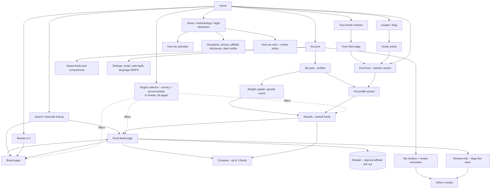
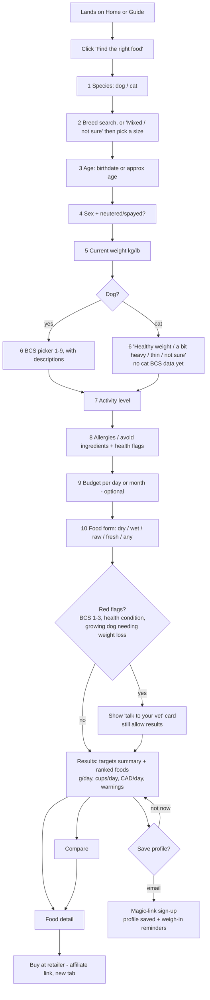
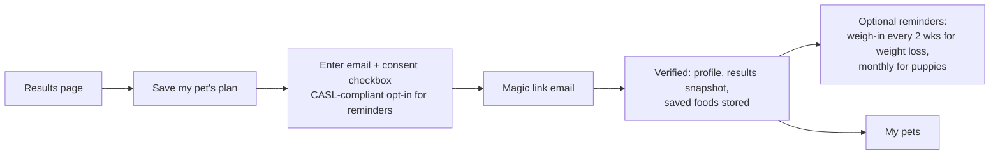
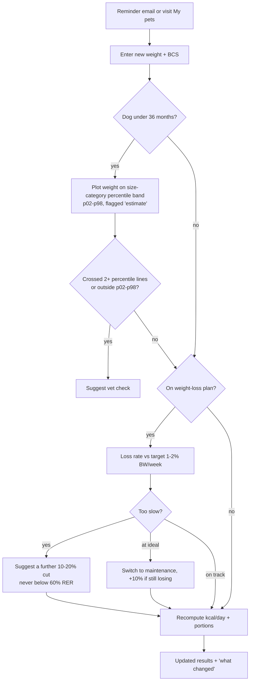
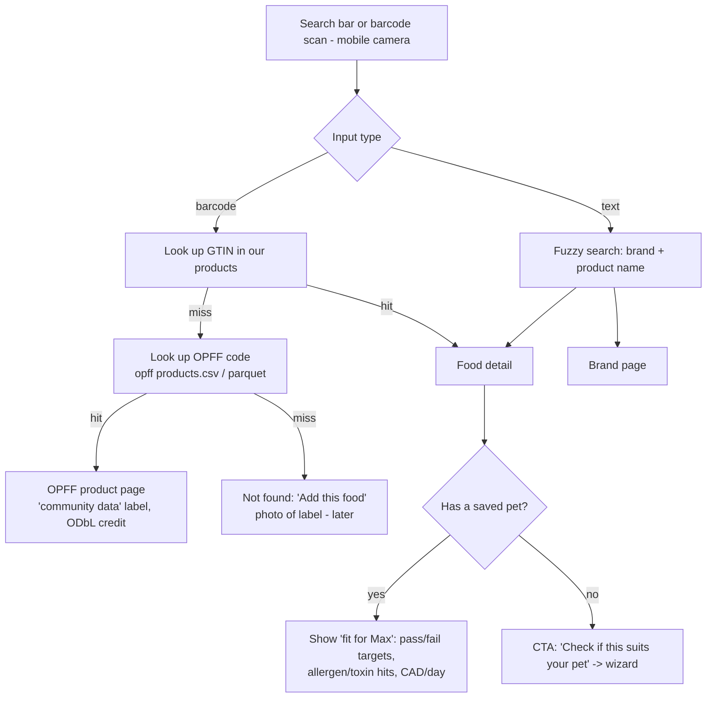
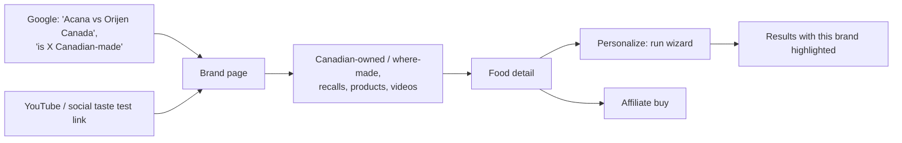
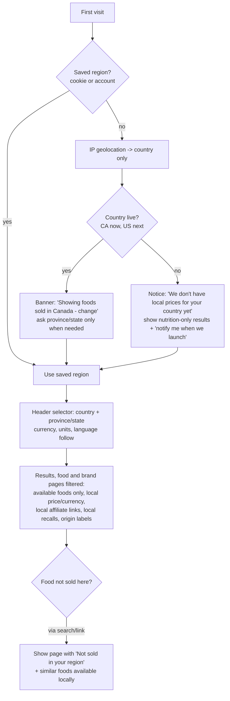
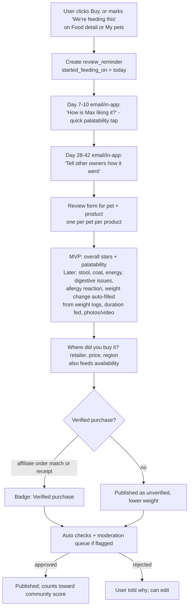
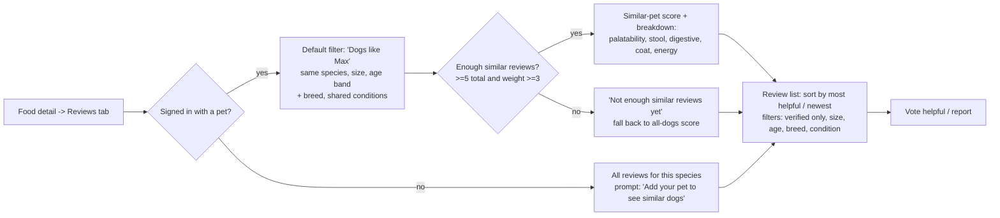

# Pet Diet & Weight Tracker: Sitemap, User Flows and Screens

*Version 2, updated 2026-10-20 (PT): adds regions/availability and reviews, per DATA_GUIDE §7. This is a companion to `DATA_GUIDE.md` in the same folder. Dataset names, formulas and gaps here match that guide. Anything marked **Proposal** is a product decision, not a fact from the data.*

**Product in one line:** a free, website-first matcher for dogs and cats. It is global, but filtered by country and region; Canada launches first, then the US. The owner builds a pet profile. The app works out the pet's calorie and nutrient targets, filters out toxic and allergen ingredients, and ranks foods that are sold in the user's region, with a local price per day, currency and affiliate "buy" links. Owner reviews add a community score, which is shown separately from nutrition fit. Later on, it adds a waitlist for an in-house organic brand.

---

## 1. Sitemap and navigation

**Global navigation (header):** Find food · Toxic foods checker · Brands · Guides · Search (with a barcode icon on mobile) · **Region selector (flag + province/state)** · Account.

**Footer:** About, How we calculate, How we rank and review policy, Data credits (the attribution list from DATA_GUIDE §6), Affiliate disclosure, Privacy, "Not veterinary advice".

**What each brand/food page shows:** ingredients (label for your country), local price per day for *your* pet in local currency, origin/ownership statements for your country (e.g. Canadian-owned / where made), local recalls (CA: Health Canada/CFIA + FDA; US: FDA), taste-test video embeds, and reviews (nutrition fit and community score shown separately). The data comes from `data/brands.csv`, `products.csv`, `prices_ca.csv`, `recalls.csv` and `videos.csv`.

---

## 2. Primary user flows

### 2.1 First-time visitor → profile → results → buy

**Wizard screens in detail**

| # | Screen | Inputs | Validation / logic | Data used |
|---|---|---|---|---|
| 1 | Species | Dog / Cat | — | — |
| 2 | Breed or size | Typeahead breed; "Mixed / not sure" → size (dogs: toy/small/medium/large/giant mapped to Salt I–VI; cats: skip) | Normalise to `breed_key`; prefill adult weight range and size category | `growth/breed_growth_index.csv` (184 dog breeds), `breeds/cat-breeds-details/cat_breeds.csv` (62 cat breeds; weight unit unlabelled, verify), alias table |
| 3 | Age | Birthdate or "about N months/years" | Dog under 36 months → growth check enabled; cat under 12 months = kitten (**Proposal** cut-off) | `growth/breed_growth_estimated.csv` (months 0–35) |
| 4 | Sex and neuter | Male/Female, neutered yes/no | Picks the MER factor | `nutrient_profiles/energy_requirements_msd.csv` |
| 5 | Weight | kg or lb | Plausibility check against the breed range and growth p02–p98 | growth CSVs, breed tables |
| 6 | Body condition | **Dog:** 1–9 cards with the text from `dog_bcs_1to9.csv` (illustrations to be commissioned; the Purina/WSAVA charts are copyrighted). **Cat:** 4-option question | BCS 6–9 → ideal = weight ÷ (1 + 10% per point over 5); BCS 1–3 → vet card (no data) | `bcs/dog_bcs_1to9.csv` |
| 7 | Activity | Low / normal / high / working | **Proposal:** low → obesity-prone factor (dog 1.4, cat 1.0); high/working → vet note (the MSD table has no working factor) | energy CSV |
| 8 | Allergies and health | Chips: chicken, beef, lamb, fish, egg, dairy, wheat, corn, soy, pea… + free text; flags: kidney, urinary, pancreatitis, diabetes, pregnant/nursing | Allergy → hard exclude; any health flag → vet card. Show prescription diets only as "ask your vet" | `pet_allergies`, figshare `dog_breed_diseases.csv` (breed predisposition info only) |
| 9 | Budget | CAD/day or /month, optional | Soft filter (ranks down, does not hide) | `data/prices_ca.csv` |
| 10 | Food form | Dry / wet / raw / fresh / any | Filter on `products.format` | `data/products.csv` |

### 2.2 Save profile / sign-up (email)

**Proposal:** no passwords; use magic links. Ask for the email only after the user has seen value, on the results page.

### 2.3 Returning user: weight update and growth check

Rules come from `bcs/dog_bcs_1to9.csv` (AAHA guidance) and `growth/*` (Salt 2017 empirical percentiles). There is no cat growth data, so cats skip the growth branch.

### 2.4 Barcode / search lookup

Note: `data/products.csv` has **no barcode column** yet (DATA_GUIDE §5 gap 9). At MVP, barcode lookup hits only OPFF (15,136 CSV rows; 254 tagged Canada).

### 2.5 Brand page visit from SEO or video

### 2.6 Region detection and selector (Proposal)

- The province/state is asked only when it changes the answer (e.g. a raw/frozen food from a regional retailer).
- Precise location is never requested.

### 2.7 Writing a review after X weeks of feeding (Proposal)

### 2.8 Browsing reviews: "dogs like mine" (Proposal)

---

## 3. Screen-by-screen table

| Screen | Purpose | Key elements | Data used (see DATA_GUIDE) | Next actions |
|---|---|---|---|---|
| **Home** | Explain the value; start the wizard | Hero "Find the right food for your dog or cat"; Start button; toxic checker teaser; popular brands; trust strip (how we calculate, data credits) | `data/brands.csv` (31), BioVet top items | Wizard, Toxic checker, Brands, Guides |
| **Pet profile wizard** (10 steps) | Collect inputs | One question per screen, progress bar, kg/lb toggle, "not sure" options, back button | `growth/breed_growth_index.csv`, `breeds/*` (CC0 tables only), `bcs/dog_bcs_1to9.csv`, energy CSV | Results; vet card |
| **Targets summary** (top of Results) | Show the maths transparently | Ideal weight, RER, kcal/day, life stage, AAFCO minimums used, "estimate" badges | energy CSV, AAFCO CSV, NRC protein (context), BCS, growth | Expand "How we calculate" |
| **Results** | Ranked foods for this pet, **only foods available in the selected region** | Cards: product, brand, format, g/day and cups/day, local cost/day in local currency (cheapest bag), **nutrition fit score and community score shown separately ("Not enough reviews yet" when below threshold)**, protein/fat per 1000 kcal vs target, badges (Canadian-owned, recall, "US label – verify", "Ca not verified"), why-ranked, Compare checkbox, Buy; filters for format, budget, Canadian-owned; "excluded foods (n)" drawer with reasons | `data/products.csv` (65), `prices_ca.csv` (61 rows / 24 products → `product_availability`), `recalls.csv`, `brands.csv`, BioVet + ASPCA, allergies, `reviews` (Proposal) | Food detail, Compare, Save, Buy |
| **Food detail** | Everything about one product | Label GA (as-fed, min/max) + per-1000-kcal conversion; kcal/kg, /cup; full ingredient list with toxin/allergen highlights and "may be truncated" note; prices by retailer and bag size with date; CAD/day for the saved pet; recalls; video embeds; data source + access date | `products.csv`, `prices_ca.csv`, `recalls.csv`, `videos.csv` (363), BioVet | Buy, Compare, Brand page, Wizard |
| **Brand page** | SEO landing; trust | Parent company, HQ, Canadian-owned (with "verify" flag where noted), where manufactured per maker, formats, product list, recall history, taste-test videos | `brands.csv`, `products.csv`, `recalls.csv`, `videos.csv`, `data.json` | Food detail, Wizard |
| **Compare** | Side by side, up to 3 | Rows: CAD/day, g/day, protein/fat/fibre per 1000 kcal, AAFCO pass, first 10 ingredients, allergen/toxin hits, Canadian-owned, recalls | same as Food detail | Buy, Food detail |
| **Region selector** (header + first-visit banner) *(Proposal)* | Show only foods sold where the user lives | Country + province/state; currency/units/language follow; "not launched yet" notice | `regions`, IP country lookup (country only) | Any page, refreshed |
| **Reviews tab** (on Food detail) *(Proposal)* | Community evidence for this food | Similar-pet score with "n similar reviews"; separate nutrition-fit score; breakdown bars (palatability, stool, digestive, coat, energy); filters: dogs/cats like mine, verified only, size, age, breed, condition; helpful votes; report | `reviews`, `review_votes`, `pets` (similarity), DATA_GUIDE §7.4 | Write review, Buy |
| **Write review** *(Proposal)* | Collect structured outcomes | Pet picker (one review per pet per product); stars + palatability (MVP); later stool/coat/energy/digestive/allergy/weight change/duration/photos/video; where bought + price; receipt upload; disclosure checkbox ("I received this free / I work for the brand") | `reviews`, `review_media`, `product_availability` (where bought), `weight_logs` | Moderation → published; My reviews |
| **My reviews + reminders** *(Proposal)* | Manage reviews; prompt at X weeks | List, edit, pending/rejected status with reason, upcoming reminders | `reviews`, `review_reminders` | Write review |
| **Moderation queue** (admin) *(Proposal)* | Keep reviews honest | Flag reason, user history, media preview, approve/reject/request edit, ban | `moderation_events` | — |
| **Toxic foods checker** | Free tool + SEO | Search "can my dog eat ___"; species toggle; verdict (safe/caution/danger), mechanism, toxic dose if known, sources; disagreement note (e.g. avocado); "call your vet" CTA | `biovet/.../items.json` (101 items, CC BY attribution), `toxicity/aspca_toxins.csv` (29) | Toxin item page, Wizard, Guides |
| **Toxin item page** | One item (e.g. grapes) | Verdict per species, notes, sources, foods in our catalogue containing it | BioVet, ASPCA, `products.csv` scan | Wizard |
| **Search / barcode** | Find a known food | Text search; camera scan (mobile) | `products.csv`, OPFF `products.csv`/parquet (ODbL credit) | Food detail, Brand page |
| **Guides / blog** | SEO + education | Articles: reading a label (min/max, per 1000 kcal), BCS, puppy growth, Canadian brands, recalls | All (cited) | Wizard |
| **My pets** (Account) | Manage profiles | Pet cards, last weight/BCS, next weigh-in, re-run results | `pets`, `weight_logs` | Weight update, Results |
| **Weight update / growth check** | Track progress | Weight + BCS entry; puppy percentile chart (estimate); weight-loss progress vs 1–2%/wk | growth CSVs, BCS CSV | Results |
| **Saved foods** | Shortlist | Saved products and comparisons, price-change notes | `prices` | Food detail, Buy |
| **Settings** | Preferences | Email, reminders, units, EN/FR (CNF is bilingual; the UI needs translation) | — | — |
| **About / How we calculate / Legal** | Trust and compliance | Method (RER/MER, AAHA, AAFCO per 1000 kcal), limits (min/max labels, estimated growth curves, no cat BCS), not-vet-advice, affiliate disclosure, data credits (OPFF ODbL, BioVet, Salt 2017, Jacobson 2019, figshare, CNF OGL, USDA), privacy | DATA_GUIDE §5–6 | — |

---

## 4. MVP vs later

| Feature | MVP | Later | Notes / data dependency |
|---|---|---|---|
| Dog wizard + results with kcal, g/day, CAD/day | ✅ | | Needs the cleaned `products` / `prices` tables |
| Cat wizard (no BCS / growth) | ✅ | Cat BCS picker + kitten growth | Needs a cat BCS source and cat growth data (gap) |
| Toxicity + allergen filter | ✅ | Ingredient-family ontology | BioVet + ASPCA; allergy families need a hand-built map |
| Food detail, brand pages, compare | ✅ | | `data/*` |
| Toxic foods checker | ✅ | | BioVet attribution required |
| Email save (magic link) + reminders | ✅ | | CASL consent |
| Puppy growth check | ✅ (bands labelled "estimate") | Breed-measured curves | Salt 2017 size-category only |
| Barcode lookup | OPFF only | Own GTINs | No barcode in `products.csv` yet |
| Recall alerts by email | | ✅ | `recalls.csv` is incomplete; needs feeds |
| **Vet-share PDF** (profile, targets, chosen food, weight history) | | ✅ | Generated from `pets`, `weight_logs`, `nutrient_targets` |
| **Multi-pet household** (shared budget, combined cart) | One pet per profile, several profiles allowed | ✅ multi-pet planning | |
| **Weight / food tracker** (daily log, charts) | Weigh-ins only | ✅ | |
| Price tracking / alerts, more retailers | 2 retailers | ✅ | Pet Valu blocked; PetSmart ranges only (data README) |
| French UI | | ✅ | Required for Quebec reach |
| **Own organic brand: waitlist** | ✅ simple email waitlist on Home/Results ("notify me") | | Separate consent |
| **Own brand: deposit / pre-order** | | ✅ | Payments, refund terms, and Canadian labelling/organic claims review (not covered by these datasets) |
| **Country/region selector + Canada availability filter** *(Proposal)* | ✅ (CA live; other countries get nutrition-only results + 'notify me') | US next, then UK/AU | `prices_ca.csv` → `product_availability`; US needs retailer + affiliate feeds |
| Local currency, affiliate links, recall sources, origin labels | ✅ CA (CAD; Health Canada/CFIA + FDA; Canadian-owned/where-made from `brands.csv`) | ✅ US (USD, FDA, Made in USA), UK (GBP, FSA), AU | Check origin-claim rules per country |
| Availability sources | Retailer scrapes/feeds + user "where I bought it" | Affiliate product feeds, barcode scans with opt-in coarse location, brand store locators | DATA_GUIDE §7.2 |
| **Reviews: simple** *(Proposal)* | ✅ stars + palatability, one per pet per product, verified badge via affiliate attribution where possible, moderation queue, review reminder at ~4–6 weeks | | Cold start = nutrition fit only |
| **Reviews: detailed outcomes** *(Proposal)* | | ✅ stool, coat, energy, digestive issues, allergy reaction, weight change, duration fed, photos/video, receipt verification | |
| **Similar-pet weighting ("dogs like mine")** *(Proposal)* | All-pets Bayesian average only | ✅ weighted by species/size/age/breed/conditions, with thresholds | DATA_GUIDE §7.4 |
| Own brand formulation tool | | ✅ (internal) | `ingredient_map` + FDC/CNF; AAFCO Chapter 6 not machine-readable |

---

## 5. Consistency notes (with DATA_GUIDE.md)

- Formulas: RER = 70 × kg^0.75; MER factors from MSD; weight loss = 80% RER at ideal weight (AAHA via the BCS CSV); per-1000-kcal = GA% × 10,000 ÷ kcal/kg.
- Warnings shown in the UI map one-to-one to the gaps in DATA_GUIDE §5:
  - "US label – verify"
  - "Ca not verified"
  - "Estimate" on growth curves
  - "No recalls found in our sources since…"
  - "Ingredient list may be truncated"
- Every page that shows BioVet, OPFF, Salt or Jacobson data must show its credit (DATA_GUIDE §6).
- Region filtering, availability statuses (available / likely / unverified / unavailable), the review schema, the community-score formula (Bayesian, similar-pet weighted, minimum thresholds, cold start = nutrition only) and the anti-fake measures are defined in DATA_GUIDE §7. All are Proposals.
- Nutrition fit and community score are always shown as two separate numbers. Reviews never override the toxin, allergen, recall or AAFCO gates.
